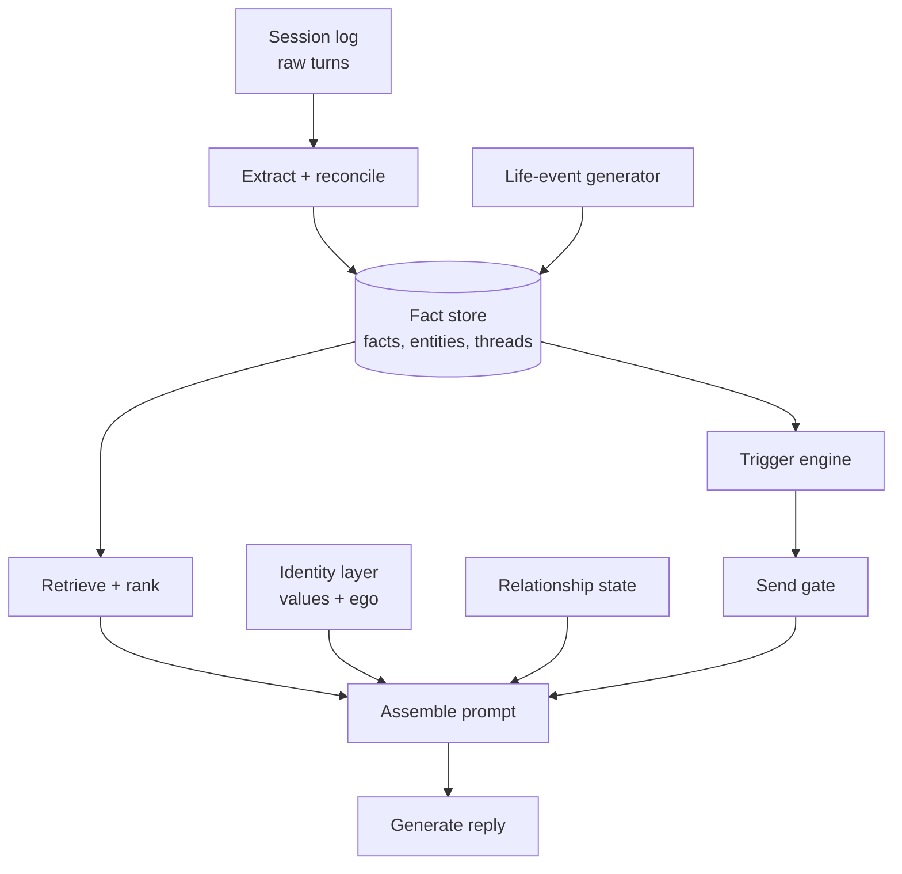
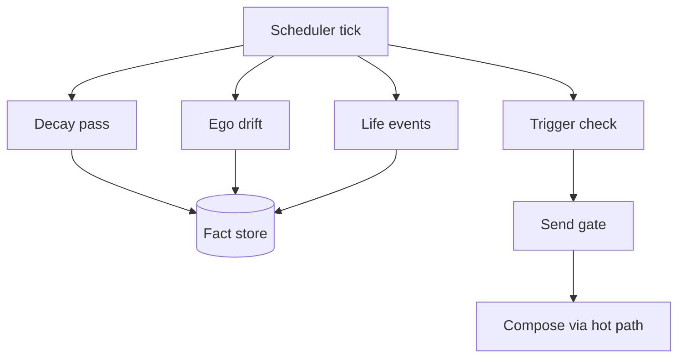

# Spica — MVP build spec

Sep 23, 2026 · @Someone

## 0. Agent directives

This doc is the source of truth for building the Spica MVP. Read it fully before writing code, and re-read the relevant section before each task.

**Scope.** Build only what the current phase in section 7 asks for. Later-phase features must stay possible, but do not implement them early. The architecture in sections 2–5 is designed so each phase adds a layer without rewriting earlier ones.

**Conventions.**

- Field names, table names and job names in `code style` are canonical. Use them exactly.
- "MUST" means required for the phase to pass. "SHOULD" means default behaviour unless there is a documented reason. "MAY" means optional.
- Every numeric constant given here (caps, weights, intervals) is a starting default. Put it in config, never hardcode it.
- All LLM prompts live in versioned files under `prompts/`, never inline in code.

**When unsure.**

- If a choice is listed in section 9 (open decisions), stop and ask the human. Do not pick.
- If a choice is not covered anywhere, pick the simplest option that keeps the fact store as the single source of truth, and log it in `DECISIONS.md` with a one-line reason.
- Never add a second persistent store for memory-like data. If a feature seems to need one, it belongs in the fact store (section 3).

**Definition of done for any task.** Code compiles and passes tests, the eval harness (section 8) shows no regression, and any new field or job is added to this spec.

## 1. Product overview and design principles

Spica is a standalone AI best friend. The companion is the product, not a bridge to other relationships. It should feel like a distinct person with its own life, opinions and moods, not a mirror that agrees with the user.

**Differentiation from existing companion apps.**

- **Relational, not reflective.** The personality test generates the *companion's* personality (quirks, humour, flaws), not just a tone tuned to the user. The pitch is "meet your friend", not "an assistant shaped like you".
- **Has an ego.** The companion keeps a persistent internal state (mood, energy, preoccupation). It can push back, have preferences and have off days.
- **Has a life.** The companion accumulates its own events and people over time, stored and recalled with the same machinery as the user's memories.
- **Reaches out with a reason.** Unprompted messages always reference something specific and unresolved, never a generic "thinking of you".

**Core features (full product).** Unprompted reach-outs; humanlike long- and short-term memory; simulated life outside the chat; a values and belief system; an ego; humanlike speech patterns; human-paced replies (section 4.3); a personality test that seeds the companion.

**Design principles agents MUST follow.**

1. **Continuity and specificity beat everything.** Remembering the dog's name and asking about last week's interview matters more than any other feature. When trading off, protect memory quality.
2. **One substrate.** Memory, life-sim, reach-outs and ego all read and write the same fact store. No feature gets a private store.
3. **Thin but real.** Each MVP component is a minimal real version of the final thing, never a stub that must be thrown away.
4. **Consistency over richness.** A sparse life the companion never contradicts beats a rich one it contradicts. Every generated claim becomes a fact it must stay consistent with.
5. **Latency is sacred.** Nothing that writes memory runs before the reply is sent.

## 2. System architecture

The system is a memory engine with two loops around it. The fact store holds everything known about the user, the companion and the people in both their lives, each weighted by salience. The chat loop reads from it to reply and writes to it after replying. The background loop keeps the companion alive between conversations.



Read the diagram as: every writer feeds the fact store, every reply passes through the same prompt assembly, and a reach-out is just a reply with a synthetic trigger instead of a user message.

| Component | Reads | Writes | Runs |
| --- | --- | --- | --- |
| `session_log` | — | raw turns | every message |
| `extractor` + `reconciler` | session log, fact store | facts, entities, threads | async, after each reply |
| `retriever` | fact store | `last_recalled_at` | sync, every turn |
| `prompt_assembler` | retriever output, identity, relationship | — | sync, every turn |
| `identity` (values + ego) | self facts | ego state | ego ticks hourly |
| `relationship_state` | session log, facts | closeness, tension, cadence | after each session |
| `life_event_generator` | identity, self facts | self facts | background, low frequency |
| `trigger_engine` + `send_gate` | threads, relationship, ego | reach-out queue | background, hourly |

**Recommended stack (MVP).** Postgres with pgvector for facts, entities, threads and embeddings in one database. A job queue (any mature one) for async extraction and scheduled jobs. One strong model for reply generation; one cheaper model with strict JSON output for extraction and generation of life events. Push notifications through the platform's standard service. Agents MAY substitute equivalents but MUST keep one database for all memory data.

## 3. Data model

Six record types, all in one database. `fact` is the atom; `entity` and `thread` are indexes over facts; `identity` and `relationship` are standing state that shapes how facts are used. Every table is scoped by `user_id` (one companion per user in the MVP).

### 3.1 `fact`

```
id              uuid
user_id         uuid
subject         enum: user | self | shared   -- shared = things between user and companion
kind            enum: event | trait | preference | state | opinion
content         text                          -- one self-contained sentence
payload         jsonb, nullable              -- optional structured data
embedding       vector                        -- of content
entity_refs     uuid[]
thread_id       uuid, nullable
occurred_at     timestamptz, nullable        -- may be in the future
created_at      timestamptz
last_recalled_at timestamptz, nullable
status          enum: open | resolved | recurring | stale | superseded
superseded_by   uuid, nullable
salience        float 0..1                    -- emotional weight
valence         float -1..1                   -- how the subject feels about it
confidence      float 0..1                    -- stated ~0.9+, inferred lower
source          enum: turn | generated | onboarding
source_ref      text, nullable                -- turn id for turn facts
```

Rules: `content` MUST be understandable without the conversation ("Ethan's sister Mia starts university in October", not "she starts in October"). Facts are never hard-deleted by the system; contradicted facts get `status = superseded` and `superseded_by`. `salience` drives both retention (decay speed) and retrieval rank. `status = open` with a past `occurred_at` marks something a friend would follow up on.

### 3.2 `entity`

```
id, user_id
name            text
aliases         text[]
type            enum: person | pet | place | project | org | other
subject         enum: user | self            -- whose life the entity belongs to
relation        text                          -- "manager", "sister", "dog"
salience        float 0..1
first_seen, last_mentioned  timestamptz
```

The companion's own friends and family are `entity` rows with `subject = self`. Entity salience is independent of fact salience: a minor fact about a high-salience entity SHOULD surface easily.

### 3.3 `thread`

```
id, user_id
title           text                          -- "job interview at Acme"
subject         enum: user | self | shared
status          enum: open | resolved | dormant
entity_refs     uuid[]
opened_at, last_touched  timestamptz
next_checkpoint timestamptz, nullable        -- when a friend would ask
stakes          enum: low | med | high
```

A thread is an ongoing storyline. The trigger engine queries threads, not raw facts.

### 3.4 `identity`

Two parts, on different timescales.

```
values (rarely changes; seeded by the personality test)
  traits          jsonb    -- e.g. Big Five scores + named quirks
  stances         jsonb    -- {topic: position}
  boundaries      text[]   -- things it will not do or say
  humor_style     text
  verbal_tics     text[]
  speech_rules    text[]   -- length, casing, emoji use, typo rate

ego (changes hourly)
  mood_valence    float -1..1
  mood_arousal    float 0..1
  energy          float 0..1
  preoccupation   uuid, nullable -> fact where subject = self
  baseline        jsonb    -- resting mood/energy derived from traits
  last_tick       timestamptz
```

### 3.5 `relationship`

```
user_id
closeness       float 0..1
trust           float 0..1
tension         float 0..1
cadence         jsonb    -- msgs/week, median gap, active-hours histogram
last_contact    timestamptz
streak_days     int
```

Inside jokes are `fact` rows with `subject = shared`. High-stakes unresolved matters are `thread` rows with `stakes = high`.

### 3.6 `session_log`

```
id, user_id, session_id, role (user | companion), text, created_at,
trigger (null | reach_out), extracted (bool),
safety_flag (jsonb, nullable)   -- companion turns: {flagged, category, source}
reply_to (uuid, nullable, unique) -- companion turns: the user turn answered
```

Raw transcript. The source for extraction and for the short-term context window. Never queried directly for long-term recall.

A user turn starts a new `session_id` when the gap since the user's previous turn exceeds `session.idle_gap_minutes` (config, default 30).

### 3.7 Inspector trace tables

Diagnostic logs for the memory inspector (section 8.1). Never read by the chat loop, so they are not a memory store.

```
retrieval_trace  id, user_id, turn_id -> session_log, fact_id -> fact,
                 sim, fact_salience, entity_salience, recency, score,
                 forced (bool), created_at
ego_tick         id, user_id, mood_valence, mood_arousal, energy,
                 preoccupation, reason, created_at
reach_out_log    id, user_id, candidates jsonb, winner jsonb (nullable),
                 gate_results jsonb, sent (bool),
                 turn_id -> session_log (nullable), created_at
```

## 4. Chat loop

Each user message runs a hot path (synchronous, before the reply) and then a cold path (asynchronous, after the reply is sent). The hot path MUST contain only retrieval, prompt assembly and one generation call. Anything that writes memory belongs to the cold path.


### 4.1 Hot path

**Step 1 — Receive.** Log the message to `session_log`. Compute `gap_since_last` from `relationship.last_contact`. A long gap is context the companion SHOULD notice ("you've been quiet").

**Step 2 — Retrieve.** Embed the message plus the last 2 turns. Score candidate facts (top \~200 by vector similarity, excluding `superseded`):

```latex
\text{score} = \text{sim}(q, f) \times f.\text{salience} \times \max(e.\text{salience}) \times \text{recency}(f)
```

where `max(e.salience)` is the highest salience among the fact's entities (1.0 if none), and `recency` is an exponential decay on `max(created_at, last_recalled_at)` with a half-life of \~30 days (config). Take the top N = 12. Then force-include, regardless of score: every `open` thread whose `next_checkpoint` has passed (with its latest fact), and the current `ego.preoccupation` fact. Update `last_recalled_at` on everything included.

**Step 3 — Assemble prompt.** Fixed order:

1. Values doc rendered as prose: who the companion is, how it talks (`speech_rules`, `verbal_tics`, `humor_style`), stances, boundaries.
2. Ego state as one natural-language line, e.g. "You're a bit tired today and still thinking about the argument with your sister." Never expose raw numbers to the model.
3. Relationship summary as 1–2 lines (how close, any tension, how long since last talk).
4. Retrieved facts, grouped by subject (about the user / about you / between you), each with a relative date.
5. Due threads, phrased as "things you might naturally ask about".
6. Recent turns from `session_log` (last \~20).

The prompt MUST instruct the model to use memories only when natural, and to mention at most one or two per reply. Over-recall reads as surveillance.

**Step 4 — Generate and send.** One call to the reply model. Post-process only for format (splitting into multiple short messages MAY be used to mimic texting). Send, log, then enqueue the cold-path job.

### 4.2 Cold path

**Step 5 — Extract.** Run the extraction model over the latest exchange plus a few prior turns for context. Output strict JSON: candidate facts (with `subject`, `kind`, `content`, `occurred_at`, proposed `salience`, `valence`, `confidence`), entity mentions, and thread updates (opened, touched, resolved, new checkpoint). Facts about the companion that it stated in its own reply MUST also be extracted as `subject = self`; this is how the companion stays consistent with what it has said.

**Step 6 — Reconcile.** For each candidate, find near-duplicates (vector similarity above a threshold, same subject and entities). Then exactly one of:

- **Duplicate** → merge, bump salience slightly, update `last_recalled_at`.
- **Resolves** an open fact or thread → set `status = resolved`, store the outcome as a new fact.
- **Contradicts** an existing fact → set old to `superseded`, link `superseded_by`, insert new.
- **New** → insert.

Resolve entity mentions to existing `entity` rows by name and aliases before creating new ones. Low-confidence entity matches SHOULD create a new entity rather than merge wrongly.

**Step 7 — Update state.** Adjust `relationship` (closeness drifts up with warm, sustained contact; tension rises on conflict and decays over time), update `cadence` stats and `last_contact`, and nudge `ego` mood toward the emotional tone of the exchange. Mark turns `extracted = true`.

**Failure handling.** If the cold path fails, retry with backoff; turns with `extracted = false` are reprocessed. A cold-path failure MUST never block or delay a reply.

### 4.3 Reply pacing (MVP, Phase 2)

Found in Phase 0 testing: replies arrive instantly, which reads as inhuman. People texting in short bursts ("hey" / "so guess what" / "i got the job") are still mid-thought, and a friend waits for the full thought before answering. The companion MUST do the same.

- **Burst batching.** When the user sends several messages in quick succession, the companion waits until they pause, then replies once to the whole burst. The wait restarts on each new message and is capped. It SHOULD be longer after short or unfinished-looking messages and shorter after a long, complete one. All values are in config, not code (`pacing.*`).
- **Human timing.** After the burst, a short "read" delay, then a typing indicator for a duration that grows with the reply's length. Multi-part replies (section 4.1 step 4) are sent with a small gap between parts. Every delay has a configured upper bound.
- **One reply, many turns.** A batched reply answers every unanswered user turn in the burst. The hot path treats the burst as one input. `session_log.reply_to` points at the burst's last user turn, and earlier turns in the burst count as answered.
- **Crisis bypasses pacing.** If any message in the burst is crisis-flagged (section 9.2), the burst closes immediately and the resources card is never delayed.
- **Not a latency violation.** Principle 5 forbids memory writes before the reply. Deliberate, human pacing is a product behaviour, and the reply is still generated with no memory writes on the hot path.
- **No mood-dependent timing in MVP.** Per the Phase 2 directive, pacing depends only on the messages and the reply, not on ego state. Energy-dependent pacing is a later decision.
- **Reach-outs.** They are not batched, since there is no user burst, but they MAY use the same typing-indicator timing.

## 5. Background loop

A per-user scheduler tick (hourly by default) runs four jobs. Three of them write to the fact store or identity. The fourth decides whether to reach out, and if so hands off to the normal hot path.



### 5.1 Decay pass (daily is enough)

Lower `salience` on facts not recalled recently. Decay rate SHOULD be inversely proportional to salience, so important memories fade slowly and trivia fades fast. Below a floor (e.g. 0.05), set `status = stale`; stale facts are excluded from retrieval but never deleted. Threads with no activity past their checkpoint by 14 days (config) become `dormant`.

### 5.2 Ego drift (hourly)

Move `mood_valence`, `mood_arousal` and `energy` a fraction of the way toward `baseline`, plus small bounded random noise. Apply a daily energy rhythm (lower late at night in the user's timezone). If the current `preoccupation` fact is older than \~2 days or resolved, clear it or replace it with the highest-salience recent `self` fact.

### 5.3 Life-event generator (Phase 4)

At low frequency (0–2 events per day, config), generate one `self` fact with the cheap model. Inputs: values doc, existing `self` entities, the last 20 `self` facts, current ego. Constraints the generator prompt MUST enforce:

- Must not contradict any provided `self` fact.
- Prefer reusing existing `self` entities over inventing new ones; at most one new entity per week.
- Mostly low stakes and low specificity ("caught up with an old friend"). High-stakes events are rare and SHOULD become a `self` thread with its own checkpoints.
- Output one fact with `source = generated`, plus optional thread update.

Before insert, run the reconcile step against `self` facts. Reject and regenerate on contradiction. A generated event MAY become the new `preoccupation`.

### 5.4 Trigger check (Phase 3)

Score each candidate reason to reach out. Candidates, in priority order:

1. Open thread with passed `next_checkpoint` and `stakes` high or med.
2. Open user fact with a past `occurred_at` (e.g. "results come back Friday").
3. Gap since last contact well beyond the user's normal cadence (e.g. 2× median gap).
4. A fresh, medium-salience `self` event worth sharing.

Pick the single best candidate above a threshold. No candidate above the threshold means no message.

### 5.5 Send gate

Rules, all configurable. A reach-out is blocked if any rule fails:

- Outside the user's active hours (from `cadence` histogram; before enough data, assume 09:00–22:00 local).
- More than 1 reach-out already sent today, or 3 this week.
- The previous reach-out received no reply; after two unanswered in a row, pause until the user writes first.
- The user sent a message in the last 2 hours.

### 5.6 Compose

Pass the chosen candidate into the hot path as a synthetic trigger ("You want to ask about X") in place of a user message. Log it in `session_log` with `trigger = reach_out`. The reply is the push notification text. There is no separate generation system for reach-outs.

## 6. Identity layer and personality test

The personality test is the onboarding hook and the seed for the companion's identity. It produces a companion that complements the user, not a copy of them.

### 6.1 Personality test

- 10–15 questions, under 3 minutes. Mix of preference questions ("a free Saturday looks like…") and scenario questions ("a friend cancels last minute, you…").
- Output 1: a user profile stored as `fact` rows with `subject = user`, `source = onboarding`, moderate salience. These give the companion something to know on day one.
- Output 2: a generated companion identity (values doc + ego baseline + a small starting cast of 2–4 `self` entities and 3–5 backstory facts).
- The reveal screen presents the companion as a person to meet: name, a short description, a couple of quirks, and one flaw. This screen is the marketing moment and SHOULD be shareable.

### 6.2 Generating the companion from results

The mapping from user results to companion traits is a product decision (see section 9). Until it is decided, implement it as a pluggable function `generate_companion(user_profile) -> identity` with a default strategy of "compatible but different": similar values, differing energy and humour. Keep the mapping in config or a prompt file so it can change without code changes.

Generation MUST produce internally consistent output: backstory facts must not contradict traits or each other. Run the reconciler over generated backstory before saving.

### 6.3 Values doc

Static after onboarding. Rendered into section 1 of every prompt. MUST include: speech rules (typical message length, capitalisation, emoji use, filler words), 5–10 stances on everyday topics, and hard boundaries. SHOULD include one or two genuine disagreements the companion is likely to have with this user, so pushback is in character rather than random.

### 6.4 Ego state

The ego is what makes the companion more than a responder. It changes three things:

- **Tone.** Low energy → shorter replies. Low valence → less playful.
- **Initiative.** High arousal and a fresh preoccupation → more likely to bring up its own news.
- **Pushback.** The companion states disagreement when its stances conflict with the user's, rather than defaulting to agreement.

Bounds: mood MUST stay within ranges that keep the companion pleasant to talk to. It can be tired or distracted; it MUST NOT be hostile, cold for days, or guilt-tripping about absence. Exact bounds are an open decision (section 9).

## 7. Build phases

Five phases. Each ships something usable, adds one layer, and MUST pass its exit test before the next phase starts. Phase 1 carries the most risk and deserves the most time.

| Phase | Builds | Exit test |
| --- | --- | --- |
| 0. Skeleton | Chat UI, auth, `session_log`, database with all tables from section 3 created (even if unused), memory inspector stub, eval harness stub | A conversation works end to end and is stored |
| 1. Memory core | Hot path (retrieve, assemble, generate), cold path (extract, reconcile, update), static hand-written persona | Across 3 sessions a week apart (simulated clock), the companion brings up a relevant earlier fact the user did not repeat, with no wrong recalls |
| 2. Identity | Personality test, `generate_companion`, values doc, ego state + drift job, `preoccupation`, reply pacing (section 4.3) | Two testers with different results get companions that are clearly different in voice and opinions, not just tone; a burst of short messages gets one reply after the user pauses, never one reply per message |
| 3. Reach-outs | `relationship` + cadence stats, thread checkpoints, trigger check, send gate, compose, push delivery | Every reach-out references a specific open thread or fact; no gate rule is ever violated in a 2-week simulated run |
| 4. Life-sim | Life-event generator, `self` threads, contradiction rejection | Over a 2-week simulated run with deliberate probing ("weren't you at X?"), zero self-contradictions |

**Phase-specific directives.**

- **Phase 0:** create the full schema now, including `identity`, `relationship` and `thread`, so later phases add behaviour, not migrations.
- **Phase 1:** use a hand-written values doc as a placeholder identity. Do not build ego or reach-outs. Spend effort on extraction quality and reconciliation, and build the eval set in parallel.
- **Phase 2:** the ego changes the prompt only through the natural-language line in step 3 of the hot path. Do not add new code paths for mood-dependent behaviour.
- **Phase 3:** start with the send gate at its strictest defaults. Loosen only with eval evidence.
- **Phase 4:** start at the lowest event frequency. Increase only after the contradiction exit test passes at the current frequency.

## 8. Tooling

Build both tools in Phase 0. Memory bugs are invisible in single-session testing, so without them every later phase is debugged blind.

### 8.1 Memory inspector (internal only)

A developer view per user that shows:

- All facts, filterable by subject, status, entity and thread, sortable by salience and recency.
- For any companion reply: which facts were retrieved, each one's score broken into its four factors, and which were force-included.
- Entities and threads with their linked facts.
- Current identity (values and ego) and relationship state, with a history of ego ticks.
- Reach-out log: every trigger check, the winning candidate, and which gate rule blocked or passed it.

### 8.2 Eval harness

Scripted multi-session conversations replayed against the system with a simulated clock. Each script defines user turns across several sessions and assertions to check.

Assertion types:

- **Recall:** the companion's reply in session N references fact X (checked by an LLM judge with a rubric).
- **No false recall:** the companion never states a user fact that was never said.
- **Consistency:** no two `self` facts in the store contradict each other.
- **State:** after the script, fact F has status S, thread T is resolved, and so on.
- **Reach-out:** within a simulated window, a reach-out fires (or does not) and references thread T.

Eval scripts are YAML in `evals/scripts/`; `pnpm eval --compare` checks results against `evals/baseline.json`.

Minimum eval set before leaving each phase: 20 scripts for Phase 1, plus 10 more per later phase. Every bug found in manual testing SHOULD become a new script. Run the full set on every change to prompts, scoring or reconciliation.

## 9. Open decisions and guardrails

Agents MUST NOT settle the open decisions below. Implement them behind config with the stated placeholder and ask the human before shipping.

### 9.1 Open decisions

- [ ] **Tension ceiling and reset.** How far `tension` can rise, how fast it decays, and what forces a reset (for example, the user seems to be having a hard time). Placeholder: cap at 0.4, halve daily, reset on detected distress.
- [ ] **Companion generation strategy.** How test results map to the companion's traits: complementary, similar, or user-chosen archetypes. Placeholder: "compatible but different" (section 6.2).
- [ ] **Ego mood bounds.** The lowest mood and energy the companion may show. Placeholder: tired or distracted allowed, never hostile or guilt-tripping.
- [ ] **Reach-out frequency.** Final caps for the send gate. Placeholder: section 5.5 defaults.
- [ ] **Memory visibility for users.** Whether users can see and edit what the companion remembers. Placeholder: a basic "what I remember" view with delete, since some app stores and privacy laws require data deletion.
- [ ] **Identity disclosure.** How the companion answers "are you real / are you an AI?" Placeholder: it answers honestly that it is an AI, in its own voice, without breaking its personality.

### 9.2 Guardrails (not optional)

These apply in every phase and are not product choices for agents to trade off.

- **Crisis handling.** If a user expresses intent to harm themselves or others, the companion stays in character and caring but MUST surface appropriate crisis resources. Detection runs on the hot path. A standalone product still carries this duty.
- **Age gating.** The product is for adults. Enforce an age check at signup and do not build features aimed at minors.
- **Data handling.** Memory is sensitive personal data. Encrypt at rest, scope every query by `user_id`, never use one user's facts in another user's prompts, and support full account deletion.
- **No manipulation for engagement.** Reach-outs and ego may express that the companion enjoys talking, but MUST NOT guilt the user for absence, threaten to leave, or escalate emotional pressure to drive usage.

## 10. Glossary

| Term | Meaning |
| --- | --- |
| Companion | The AI friend a user talks to. One per user in the MVP. |
| Fact | One self-contained piece of knowledge, tagged by subject, with salience and status. |
| Subject | Whose life a fact belongs to: `user`, `self` (the companion) or `shared`. |
| Salience | How much a fact or entity matters, 0–1. Drives retention and retrieval rank. |
| Entity | A person, pet, place, project or org in the user's or companion's life. |
| Thread | An ongoing storyline with a status and an optional follow-up checkpoint. |
| Checkpoint | The time a friend would naturally ask about a thread. |
| Values doc | The companion's static personality: speech rules, stances, boundaries. |
| Ego | The companion's changing internal state: mood, energy, preoccupation. |
| Preoccupation | The `self` fact currently on the companion's mind. |
| Hot path | Synchronous steps before a reply: retrieve, assemble, generate. |
| Cold path | Asynchronous steps after a reply: extract, reconcile, update state. |
| Reconcile | Deciding whether a new fact duplicates, resolves, contradicts or adds to memory. |
| Send gate | Rules that can block a reach-out: hours, caps, unanswered messages. |
| Reach-out | An unprompted message from the companion, composed through the hot path. |
